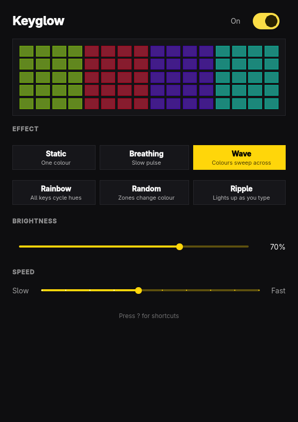

# Keyglow



Colour, effect, and brightness for the RGB keyboard backlight on laptops with
an ITE 8291 (rev 0.02, four-zone) controller, such as many Clevo-based
machines. One window, driven from the keyboard, following the Omarchy theme.

The effects run on the keyboard controller itself, so they keep going with the
window closed. A small user service puts them back after the lock screen,
suspend, and Omarchy's keyboard brightness keys, which make the driver repaint
in plain colour.

## Needs

- The `ite_8291` driver from `tuxedo-drivers-nocompatcheck-dkms` (in the
  Omarchy repository), which exposes the zones as `rgb:kbd_backlight*`.

## Install

```sh
bin/install
systemctl --user start keyglow   # once; it starts on its own from the next login
```

The package installs a udev rule that gives the logged-in session access to
the controller (`uaccess`), so nothing runs as root.

## Effects

| Effect | Colour | What it does |
|---|---|---|
| Static | yes | One colour on every key |
| Breathing | yes | Slow pulse |
| Wave | no | Colours sweep across the zones |
| Rainbow | no | All keys cycle through the hues |
| Random | no | Zones change colour |
| Ripple | yes | Lights up as you type |

## Shortcuts

| Key | Action |
|---|---|
| `1` – `6` | Pick an effect |
| `Space` | Turn the light on or off |
| `←` `→` | Brightness down or up |
| `[` `]` | Slower or faster |
| `C` | Next preset colour |
| `Ctrl+Z` / `Ctrl+Shift+Z` | Undo / redo |
| `?` | Show the shortcuts |
| `Q` | Quit |

## Command line

```sh
keyglow status --json
keyglow set --mode breathing --color '#9b4dff' --brightness 60 --speed 4
keyglow set --toggle
keyglow apply        # send the saved lighting again
keyglow daemon       # what keyglow.service runs
```

Each command exits 0 on success, or 1 with the reason on stderr. The state
lives in `~/.config/keyglow/state.json`.

## Develop

```sh
bin/build   # build/keyglow
bin/test    # Qt Test, offscreen, against a fake sysfs tree
```
